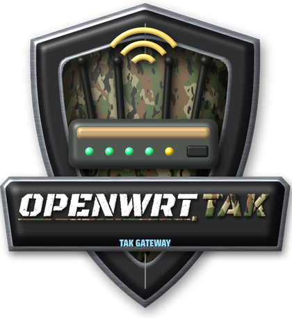

# OpenWrt-TAK – TAK gateway for OpenWrt routers and WiFi Pineapples

<p align="center"></p>

[](https://www.buymeacoffee.com/sect0101)

`tak-gateway` puts an OpenWrt router (or a Hak5 WiFi Pineapple) on the TAK map and connects the ATAK / iTAK / WinTAK users on its local networks to a TAK Server.

- **Bridges TAK multicast.** SA (`239.2.3.1:6969`) and GeoChat (`224.10.10.1:17012`) are relayed between the networks you pick (LAN, a mesh, HaLow) and your TAK Server.
- **Talks to the TAK Server** over TLS with a client certificate (8089) or plain TCP (8087), reconnecting by itself and sending keep-alives.
- **De-duplicates** traffic and never echoes a unit back onto the network it came from.
- **Understands TAK Protocol v1** (protobuf) mesh packets as well as XML.
- **Reports its own position** from a fixed location or a GPS through gpsd, with team color, role and map symbol.
- **One-click setup**: import the connection data package (.zip) your TAK Server admin gives you.
- **Status page** in LuCI with the server connection, traffic counters and every local TAK user it has heard.

| Package | What it is |
|---|---|
| `tak-gateway` | The daemon (Go, standard library only), UCI config `/etc/config/tak-gateway`, procd service |
| `luci-app-tak-gateway` | Web page under **Services > TAK Gateway** |
| `hak5/` | Bundles for the WiFi Pineapple Pager, Mark VII (mipsel) and Tetra (mips) |

## OpenWrt One (OpenWrt 25.12, apk)

Download the two `.apk` files from the latest [release](https://github.com/SECT0101/OpenWrt-TAK/releases/latest), copy them to the router's `/tmp`, then:

```sh
apk add --allow-untrusted /tmp/tak-gateway-*.apk /tmp/luci-app-tak-gateway-*.apk
```

`--allow-untrusted` is needed because these packages are not signed with the OpenWrt key.
Then open LuCI, **Services > TAK Gateway**:

1. **TAK Server > Import data package (.zip)** - fills in the server, port and certificates.
2. **This device** - tick *Enable*, set a callsign and the router's position (or *Use GPS*).
3. **Local TAK users** - pick the networks your TAK users are on (`lan`, mesh, HaLow...).
4. **Save & Apply.** The status box at the top shows the connection and every TAK user heard.

## WiFi Pineapple Pager / Mark VII / Tetra

Download from the latest [release](https://github.com/SECT0101/OpenWrt-TAK/releases/latest): `tak-gateway-<version>-hak5-mipsel.tar.gz` for the Pager and Mark VII, `tak-gateway-<version>-hak5-mips.tar.gz` for the Tetra.

```sh
scp tak-gateway-*-hak5-mipsel.tar.gz root@172.16.52.1:/tmp/
ssh root@172.16.52.1
cd /tmp && tar xzf tak-gateway-*-hak5-mipsel.tar.gz && sh tak-gateway/install.sh
```

The installer checks the bundle matches the CPU and prints the `uci` commands to finish setup.

## Command line

```
tak-gateway -callsign SHOP-ONE -lat 38.8895 -lon -77.0353 \
  -server tak.example.org -port 8089 -proto ssl \
  -cert client.crt.pem -key client.key.pem -ca ca.pem \
  -iface br-lan,wlan2
tak-gateway import [-password PW] data-package.zip   # or client.p12
tak-gateway -h                                        # every option
```

Status is written to `/var/run/tak-gateway.json` every 5 seconds.

## Building

- `hak5/build.sh` builds the Hak5 bundles into `dist/` (needs Go 1.21+).
- The OpenWrt packages build with the OpenWrt SDK; `.github/workflows/build.yml` does it on every push to `main`. Tag `vX.Y.Z` to publish a release with all files attached.
- Tests: `cd tak-gateway/src && go test ./...` (set `TAK_GATEWAY_LAB=1 TAK_TEST_IFACE=eth0` to also run the end-to-end test with a TLS TAK Server and real multicast).

## License

[MIT](LICENSE). TAK is a product of the TAK Product Center; this is an unofficial community project, not affiliated with the TAK Product Center, Hak5 LLC or OpenWrt.
